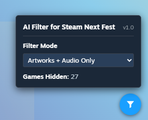

# AI Filter for Steam Next Fest

Hides Steam Next Fest games that disclose AI-generated content. You can hide every game with an AI disclosure, or only the ones that used AI for artwork and/or audio.

## Install

### Firefox

Install the add-on from Firefox Add-ons:

**[AI Filter for Steam Next Fest on addons.mozilla.org](https://addons.mozilla.org/en-US/firefox/addon/ai-filter-for-steam-next-fest/)**

### Chrome, Edge, Opera, Brave (userscript)

There's no Chrome Web Store version (publishing there costs money). Use the userscript instead; it's the same code.

1. Install a userscript manager:
   - [Tampermonkey](https://www.tampermonkey.net/) (Chrome, Edge, Opera, Brave, Safari, Firefox)
   - [Violentmonkey](https://violentmonkey.github.io/) (Firefox)
   - [Greasemonkey](https://addons.mozilla.org/firefox/addon/greasemonkey/) (Firefox only)
2. **Chrome and Edge only:** allow user scripts, or the script won't run. Open the browser's extensions page (`chrome://extensions` or `edge://extensions`), click **Details** on Tampermonkey, and turn on **Allow User Scripts**. On older browser versions, turn on **Developer mode** on the extensions page instead.
3. Open **[nextfest-hide-ai.user.js](https://github.com/BeGe-01/nextfest-hide-ai/raw/main/nextfest-hide-ai.user.js)**. Your userscript manager shows an install screen; click **Install**.
4. Go to the [Steam Next Fest page](https://store.steampowered.com/sale/nextfest).

Tampermonkey and Violentmonkey check this repo for updates automatically.

## Usage

Click the filter button in the bottom-right corner of the Next Fest page and pick a **Filter Mode**:

| Mode | Hides games that disclose… |
|---|---|
| All | any AI-generated content (includes codes, translations, etc.)|
| Artworks + Audio Only *(default)* | AI artwork or AI audio |
| Artworks Only | AI artwork |
| Audio Only | AI music, sound effects or voices |
| Off | nothing; everything is shown |

**Games Hidden** shows how many games the current mode hides. While new games are being checked, a **Checking... (N)** label appears next to the button. New games are checked as you click **Show more**.

## How it works

Steam asks developers to disclose AI-generated content on their store page. For each game on the Next Fest page, the filter reads that disclosure from Steam's store API, 100 games per request.

- **All** only checks whether a disclosure exists, so it's exact.
- **Artworks** and **Audio** read the disclosure text and look for words like "artwork", "sprites", "music" or "voice", while skipping sentences that deny them ("No AI was used for the art"). This works for English, Chinese, Japanese and Korean, but unusual wording can be misjudged. If a game looks wrongly hidden, read the disclosure on its store page.

Results are saved in your browser, so games you've already seen are filtered instantly next time.

## Privacy

The filter collects no data. It only talks to Steam to read each game's public disclosure, and it stores its results in your own browser.

## License

[MIT](LICENSE)

---

Steam and the Steam logo are trademarks of Valve Corporation. This project is not affiliated with or endorsed by Valve.
